# Manual del alumnado

Cómo se usa TutorIA como alumno o alumna: ver tus ejercicios, resolverlos con la ayuda del tutor, entregarlos y ajustar la aplicación a tu gusto.

> Generado con `npm run manual` el 26/11/2026 a partir de las tareas guiadas de la aplicación: cada tarea se hizo de principio a fin en el navegador, con los datos de demostración, y cada paso lleva el texto de su globo y su captura. No se edita a mano: se vuelve a generar cuando cambian las tareas o las pantallas.

Todo lo que cuenta este manual está también dentro de la aplicación: el botón «Ayuda» (?), arriba a la derecha, hace estas mismas tareas contigo sobre tus propios datos.

## Índice

- [Bienvenida](#bienvenida)
- Primeros pasos
  - [Empezar un ejercicio](#start-exercise)
  - [Ejecutar las pruebas](#run-tests)
  - [Pedir una pista al tutor](#ask-hint)
  - [Entregar](#submit)
- ¿Cómo se hace…?
  - [Cambiar el idioma](#change-language)
  - [Cambiar el tema: claro u oscuro](#change-theme)
  - [Cambiar de asignatura](#change-subject)
  - [Cerrar sesión](#sign-out)
  - [Ver por qué falla una prueba](#failing-test)
  - [Preguntar al tutor con tus palabras](#ask-question)
  - [Escuchar, dictar o llamar al tutor](#talk)
  - [Configurar la voz del tutor](#voice)
  - [Cambiar las reacciones del tutor](#reactions)
  - [Vestir a la mascota](#mascot)
  - [Que el tutor te escriba solo, o no](#proactive)
  - [Ajustar la pantalla de trabajo](#arrange-workspace)
  - [Ordenar tu código](#format-code)
  - [Practicar de nuevo un ejercicio entregado](#practise-again)
  - [Volver a un intento anterior](#previous-attempt)
  - [Pasar al siguiente ejercicio](#next-exercise)
  - [Ver qué datos se registran](#registered-data)
- Recorridos de pantalla
  - [Conocer tus ejercicios](#tour-catalog)
  - [Conocer la pantalla de trabajo](#tour-workspace)
  - [Conocer tus ajustes](#tour-settings)
  - [Conocer tus datos registrados](#tour-registered-data)

## Bienvenida

Lo primero que ves al entrar por primera vez. Se puede volver a ver desde «Ayuda» › «Ver la bienvenida».

### 1. ¡Hola, Lucía!

Soy el tutor de TutorIA. Te enseño en un momento dónde está cada cosa; puedes saltarlo cuando quieras.

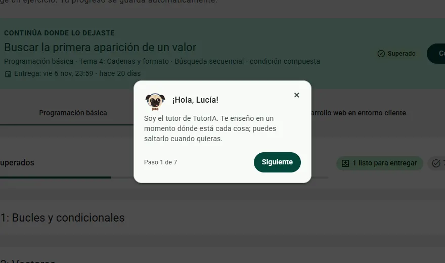

### 2. La ayuda

Aquí la tienes siempre: los primeros pasos, cómo se hace cada cosa y el recorrido de cada pantalla, pieza a pieza.

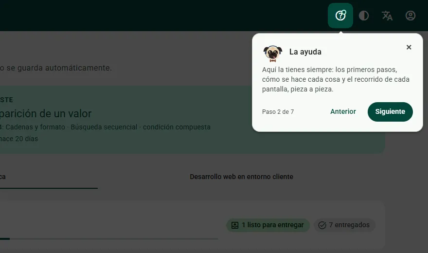

### 3. Claro u oscuro

El tema: claro, oscuro o el de tu sistema. Pruébalo ahora si quieres.

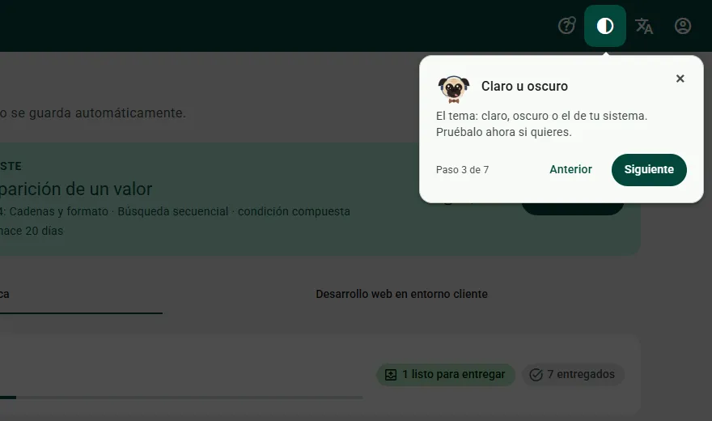

### 4. Tu idioma

Español, català o English. Si prefieres otro, elígelo ahora y seguimos en él.

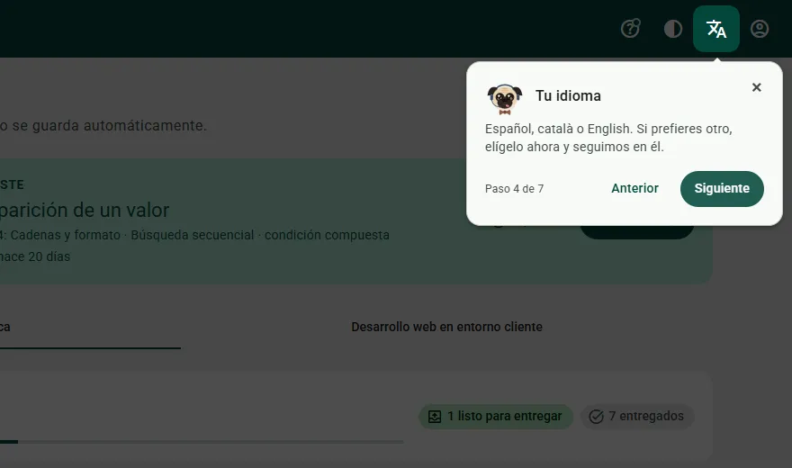

### 5. Tu menú

Tus ajustes (la mascota, las reacciones, la voz del tutor), tus datos registrados y «Cerrar sesión».

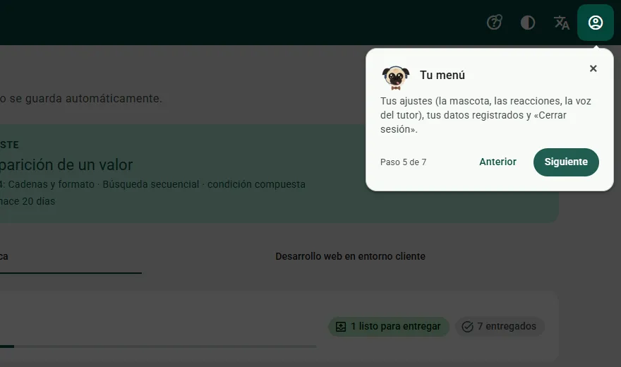

### 6. Tus asignaturas

Cada una tiene sus ejercicios, ordenados por temas.

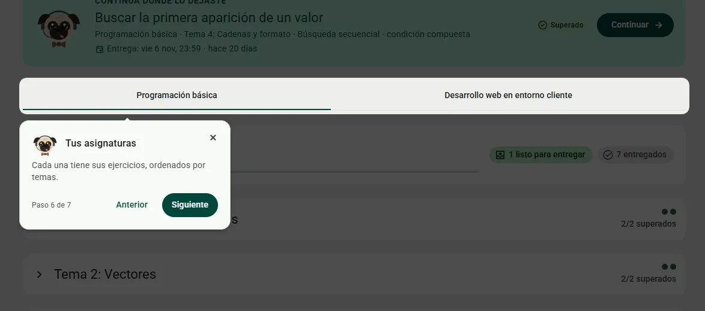

### 7. Por dónde seguir

Aquí tienes siempre tu siguiente ejercicio, o el que dejaste a medias.

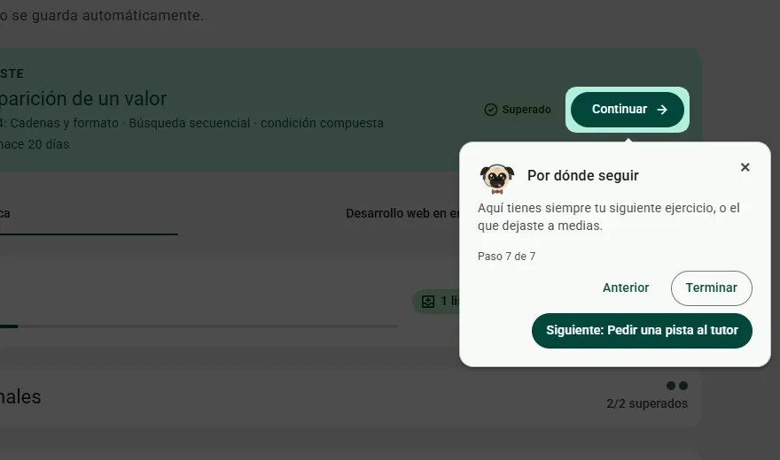

## Primeros pasos

### Empezar un ejercicio

_Abrir un ejercicio y saber dónde se escribe._

#### 1. Tu siguiente ejercicio

El catálogo te propone siempre por dónde seguir.

**Qué haces:** Pulsa «Empezar» o «Continuar»

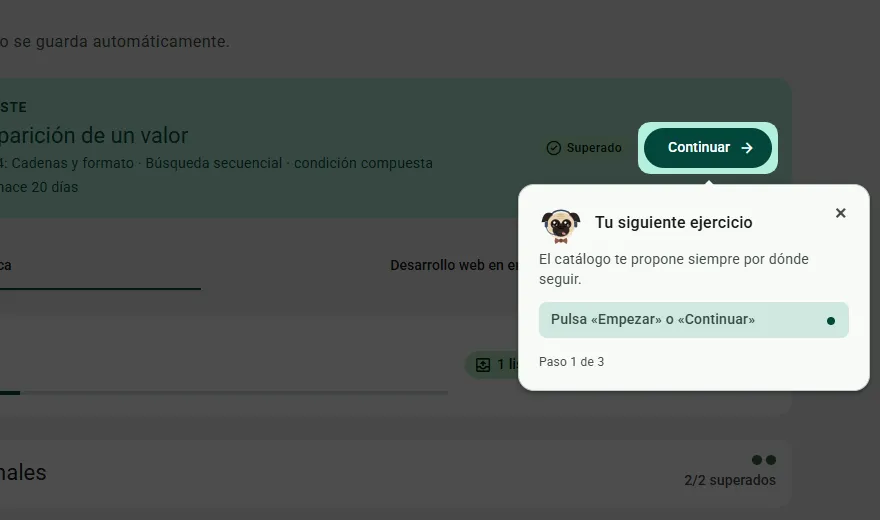

#### 2. El enunciado

Qué tiene que hacer tu función, con ejemplos de lo que recibe y lo que devuelve.

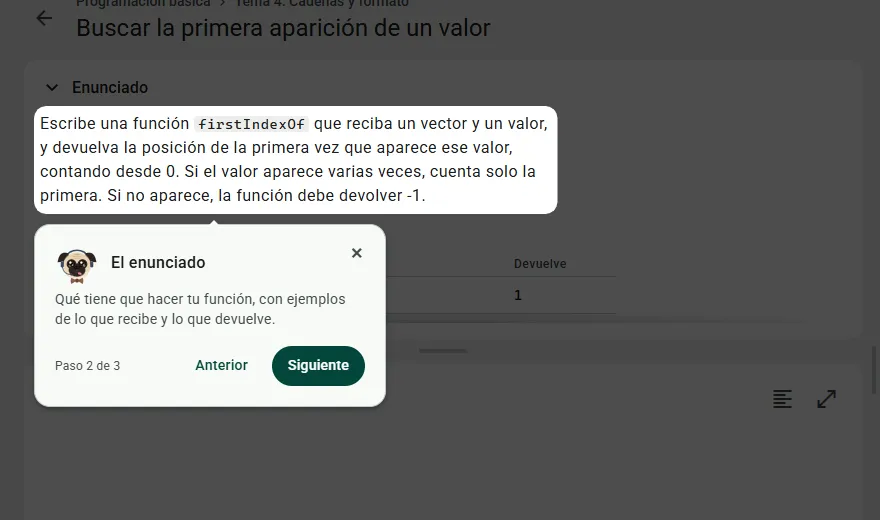

#### 3. Aquí escribes

Tu código se guarda solo mientras escribes. Cuando quieras, ejecuta las pruebas.

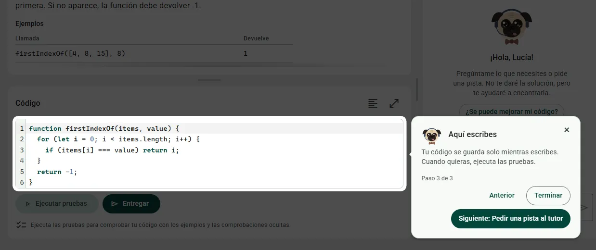

### Ejecutar las pruebas

_Comprobar tu código con los ejemplos y las pruebas ocultas._

#### 1. Ejecutar las pruebas

Comprueban tu código con los ejemplos y con otras pruebas ocultas. Desde el editor, también con Ctrl + Intro.

**Qué haces:** Pulsa «Ejecutar pruebas»

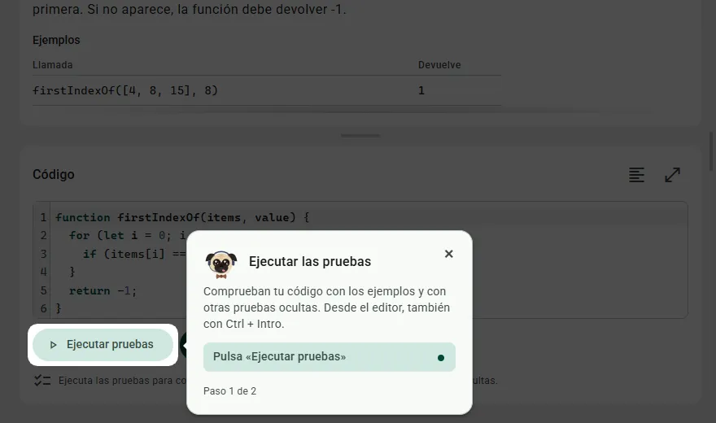

#### 2. Los resultados

Cada prueba dice si pasa y, si falla, qué esperaba. De las ocultas solo sabrás si las superas.

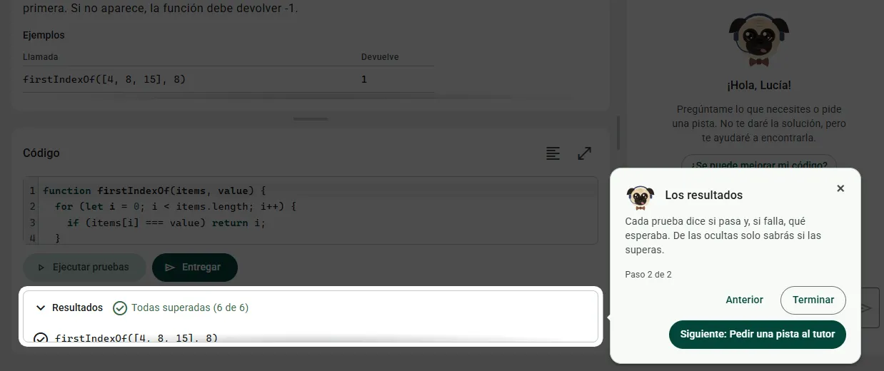

### Pedir una pista al tutor

_Pedir ayuda sin que te den la solución._

#### 1. Pedir una pista

El tutor te ayuda a avanzar sin darte nunca la solución.

**Qué haces:** Pulsa «Pedir pista»

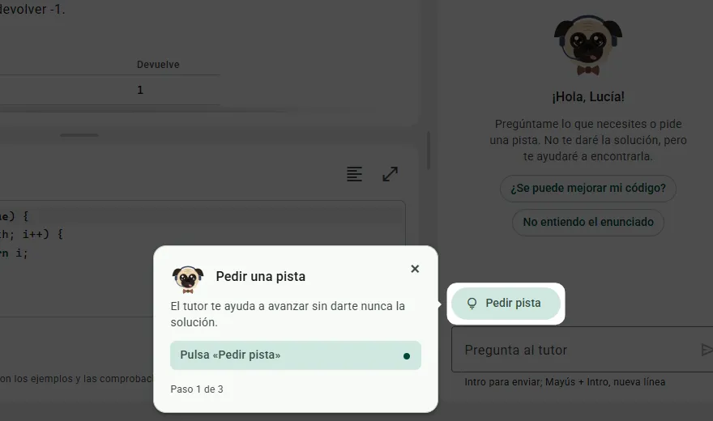

#### 2. De menos a más

Cada pista te ayuda un poco más que la anterior. Aquí ves por cuál vas.

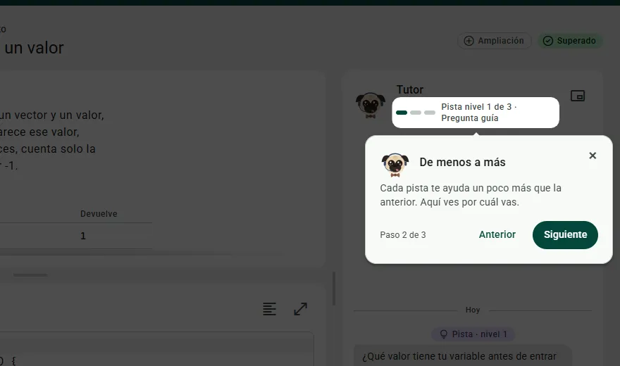

#### 3. Pregúntale

También puedes escribirle tu duda con tus palabras, o pedirle que te explique un error.

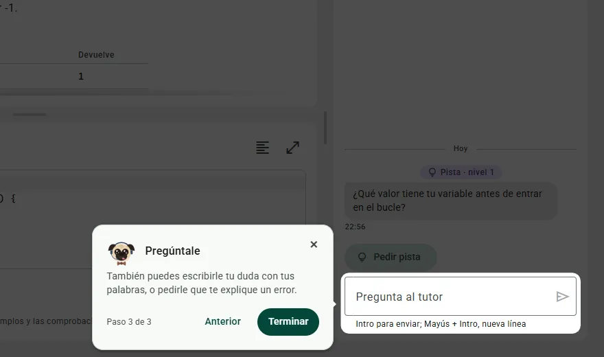

### Entregar

_Entregar un ejercicio cuando supera todas las pruebas._

#### 1. Entregar

Cuando tu código supera todas las pruebas, se lo entregas a tu docente. Es definitivo: después ya no se puede cambiar.

**Qué haces:** Pulsa «Entregar»

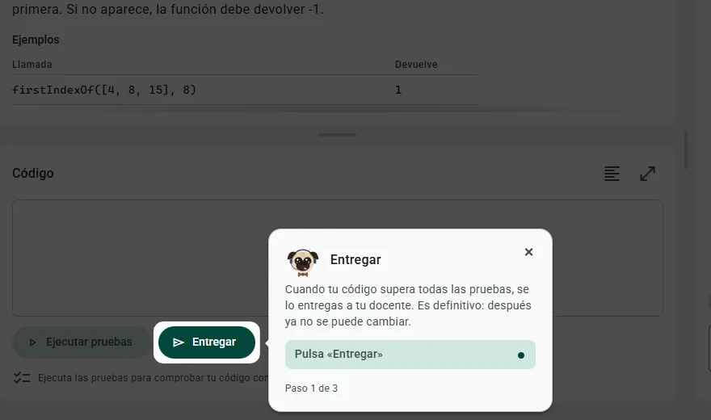

#### 2. Confírmalo

Si aún quieres repasarlo, «Seguir revisando» te deja seguir trabajando.

**Qué haces:** Pulsa «Entregar» para confirmarlo

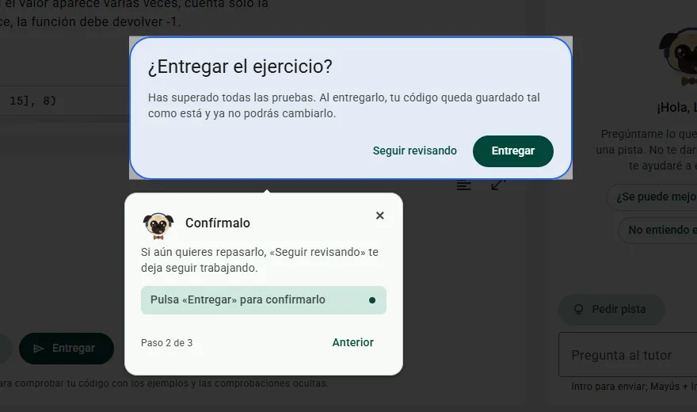

#### 3. ¡Entregado!

Tu docente ya lo ve. Si quieres, puedes practicarlo de nuevo sin cambiar lo entregado.

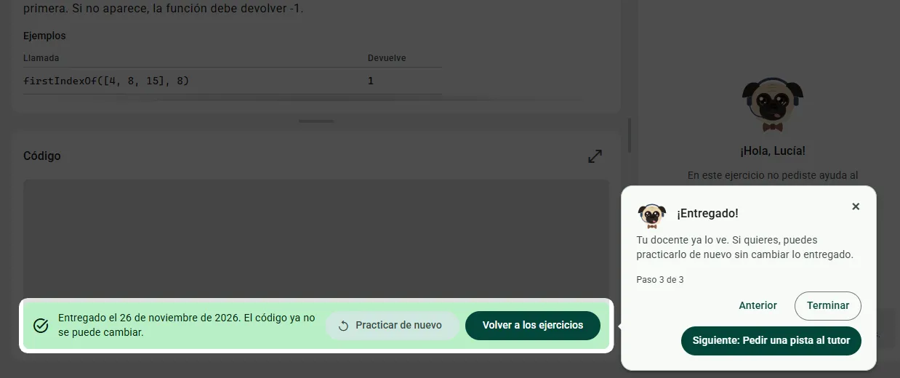

## ¿Cómo se hace…?

### Cambiar el idioma

_Español, català o English, desde la barra._

#### 1. El idioma

Pulsa aquí y elige el tuyo: la aplicación se vuelve a abrir en él. Los ejercicios también se ven en tu idioma cuando tu docente los traduce.

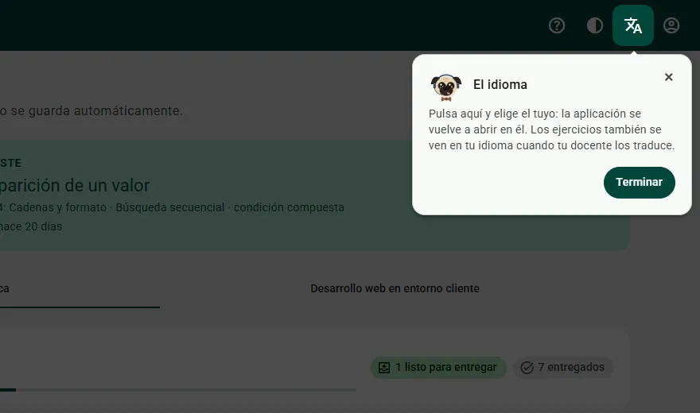

### Cambiar el tema: claro u oscuro

_Desde la barra, en cualquier pantalla._

#### 1. El tema

Pulsa aquí y elige claro, oscuro o el de tu sistema. Se aplica al momento. También está en Ajustes.

### Cambiar de asignatura

_Ver los ejercicios de otra asignatura._

#### 1. Tus asignaturas

Pulsa una pestaña para ver sus temas y ejercicios. Tu siguiente ejercicio, arriba, es el de cualquiera de ellas.

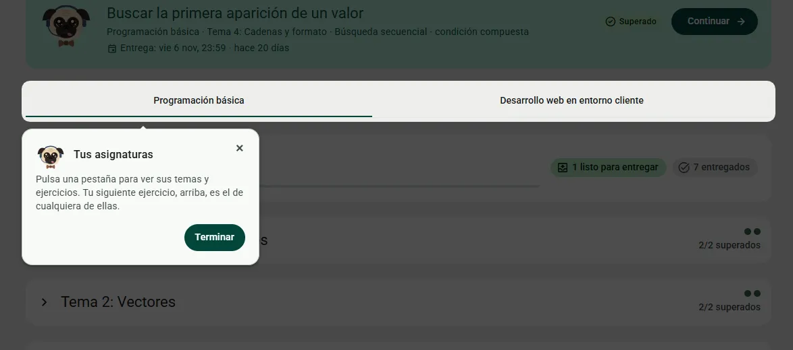

### Cerrar sesión

_Salir, sobre todo en un ordenador compartido._

#### 1. Tu menú

Arriba a la derecha, en cualquier pantalla.

**Qué haces:** Abre tu menú

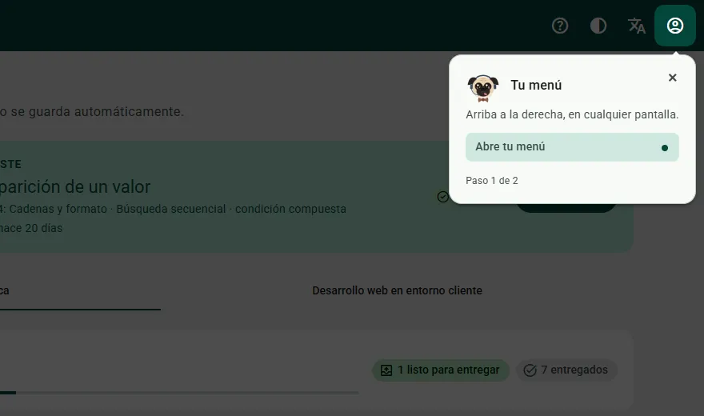

#### 2. Cerrar sesión

Púlsalo cuando acabes. Tu código ya está guardado.

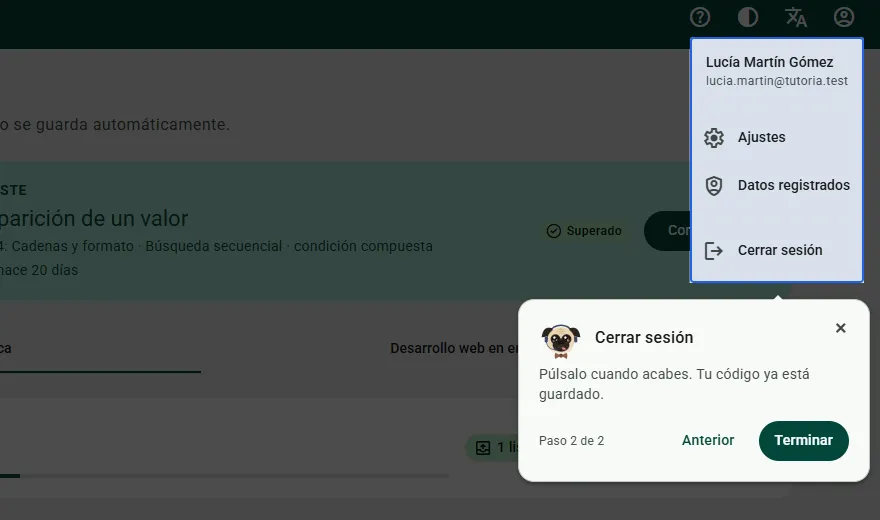

### Ver por qué falla una prueba

_Qué esperaba, qué devolvió y cómo preguntarle al tutor._

#### 1. Ejecuta las pruebas

Primero, comprueba tu código.

**Qué haces:** Pulsa «Ejecutar pruebas»

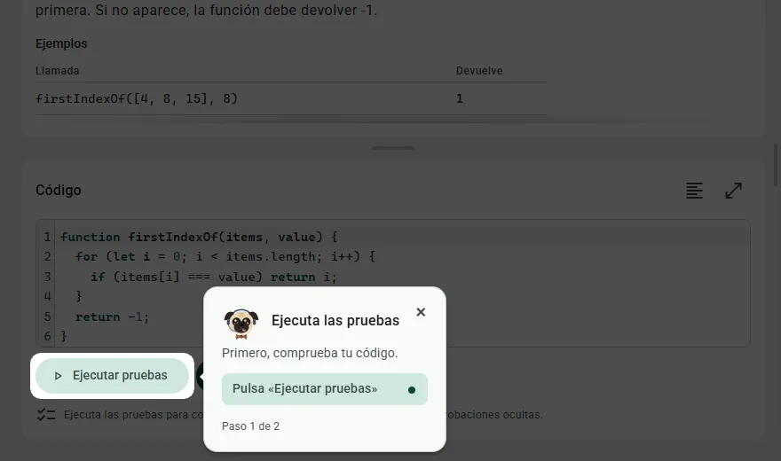

#### 2. Cada prueba

La llamada a tu función y, si falla, lo que esperaba y lo que devolvió. De las ocultas solo sabrás si las superas.

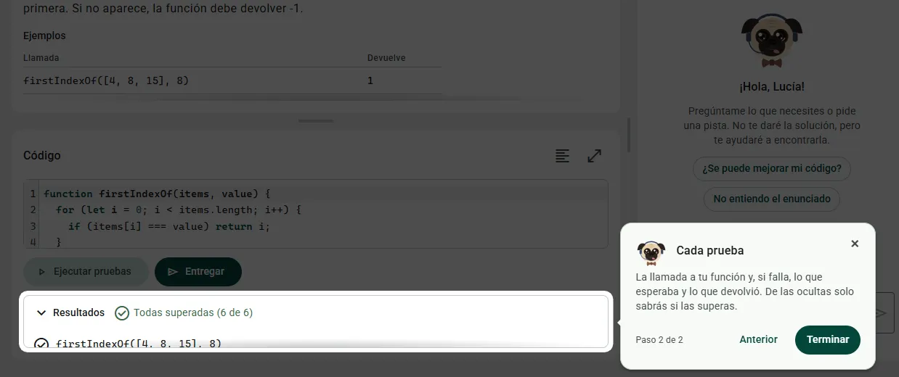

### Preguntar al tutor con tus palabras

_Escribirle, dictarle o usar una pregunta sugerida._

#### 1. Preguntas sugeridas

Para empezar con un clic, si no sabes cómo preguntarle.

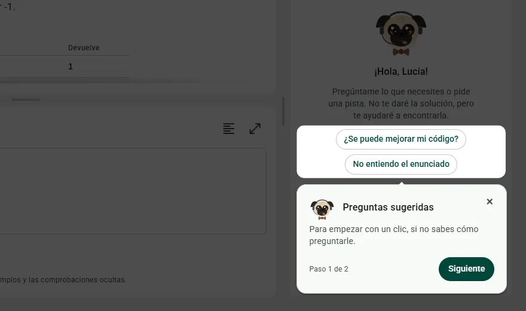

#### 2. Tu pregunta

Escríbele tu duda como se la dirías a un profesor. Intro la envía; Mayús + Intro, nueva línea.

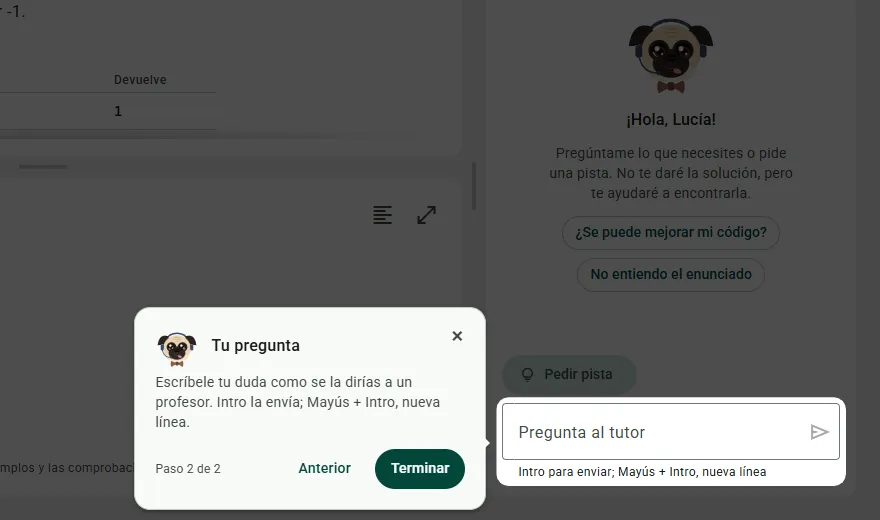

### Escuchar, dictar o llamar al tutor

_Usar la voz en un ejercicio._

#### 1. Nunca se graba el audio

Si no ves estos botones, activa «Hablar con el tutor por voz» en Ajustes.

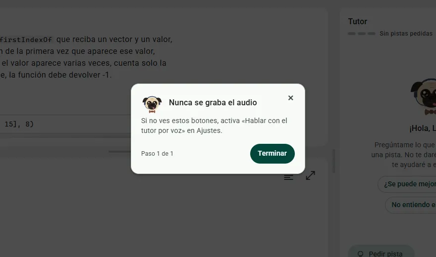

### Configurar la voz del tutor

_Activarla, elegir su voz y su velocidad, y dónde se reconoce la tuya._

#### 1. Hablar con el tutor por voz

Para escuchar sus respuestas, dictarle y llamarle. Actívala y te enseño sus opciones; puedes desactivarla cuando quieras.

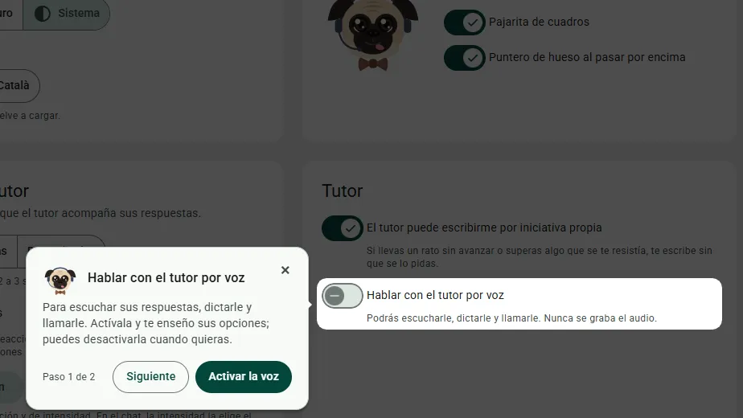

#### 2. La voz del tutor

Elige entre las voces de tu equipo; escúchalas antes de quedarte con una.

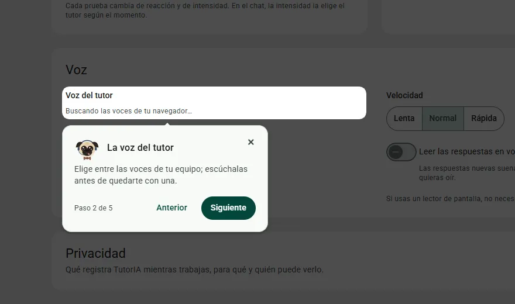

#### 3. La velocidad

Lenta, normal o rápida.

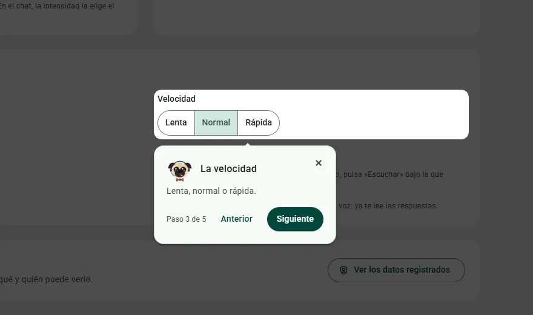

#### 4. Leer las respuestas

Te lee en voz alta cada respuesta nueva, sin pulsar «Escuchar».

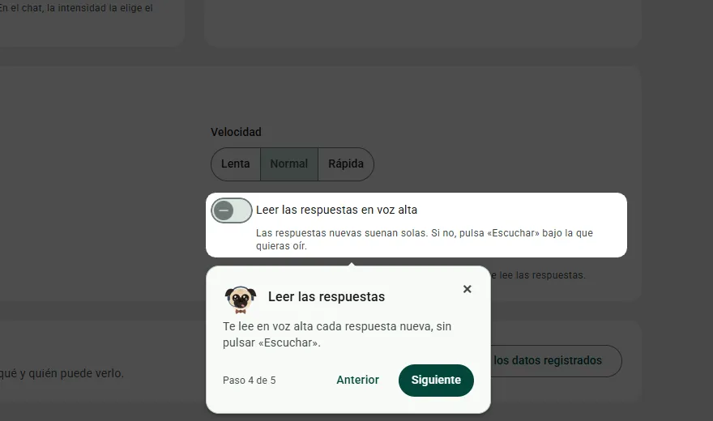

#### 5. En cada ejercicio

Con la voz activada, junto al tutor tienes «Escuchar», «Dictar» y «Llamar al tutor». Nunca se graba el audio.

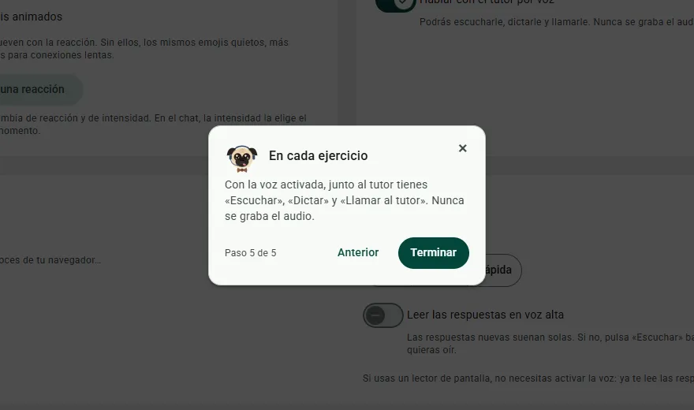

### Cambiar las reacciones del tutor

_Más, menos o ningún emoji en sus respuestas._

#### 1. Las reacciones

Completas, reducidas o desactivadas.

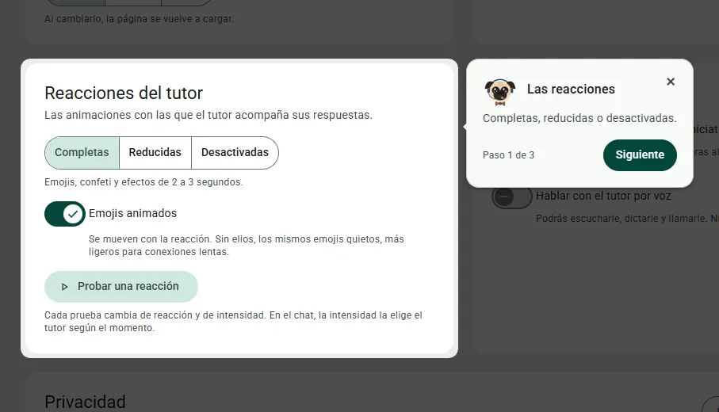

#### 2. Emojis animados

Sin ellos, los mismos emojis quietos, más ligeros.

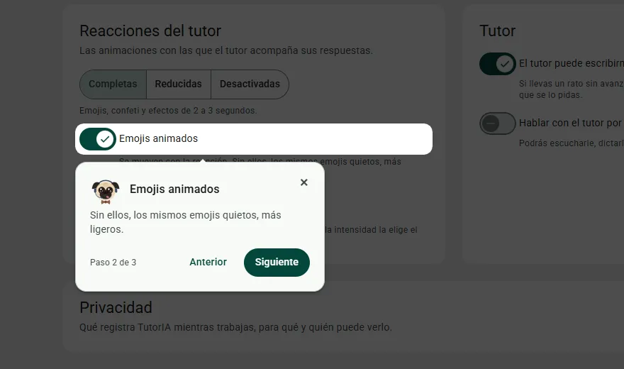

#### 3. Pruébalo

Para ver cómo queda.

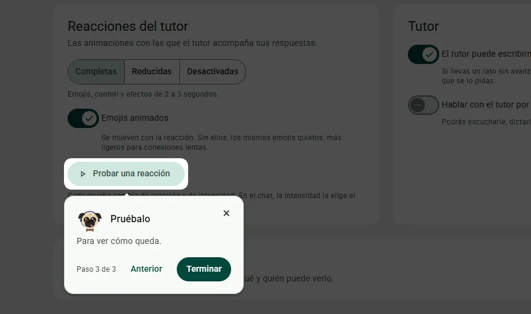

### Vestir a la mascota

_Los cascos, la pajarita y el puntero de hueso._

#### 1. La mascota

Ponle o quítale los cascos y la pajarita, y elige si el puntero se vuelve un hueso sobre ella.

### Que el tutor te escriba solo, o no

_Cuando llevas un rato sin avanzar o superas algo difícil._

#### 1. El tutor te escribe

Si llevas un rato sin avanzar, o superas algo que se te resistía, te escribe sin que se lo pidas. Desactívalo si prefieres que solo te conteste.

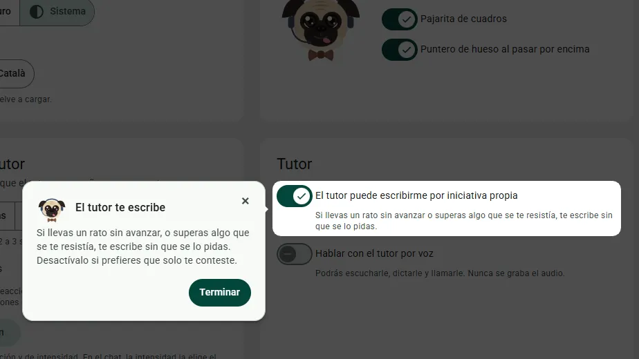

### Ajustar la pantalla de trabajo

_Más sitio para el código, el enunciado o el tutor._

#### 1. A tu medida

Reparte la pantalla como te vaya mejor; se recuerda para la próxima vez.

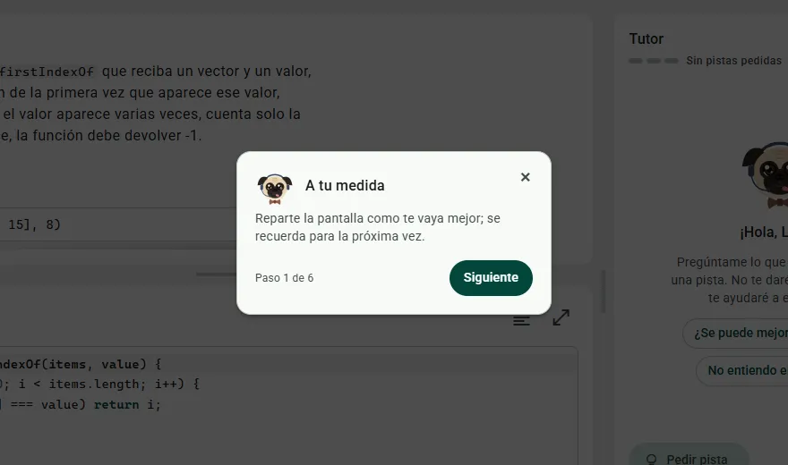

#### 2. Plegar el enunciado

Pliégalo cuando ya lo tengas claro y el código ganará sitio.

#### 3. Más enunciado o más código

Arrástralo, o usa las flechas del teclado, para repartir el alto entre el enunciado y el código.

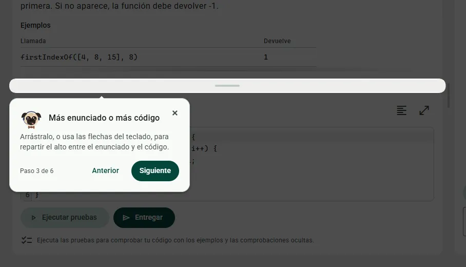

#### 4. Más código o más tutor

Arrástralo, o usa las flechas del teclado, para repartir el ancho entre el código y el tutor.

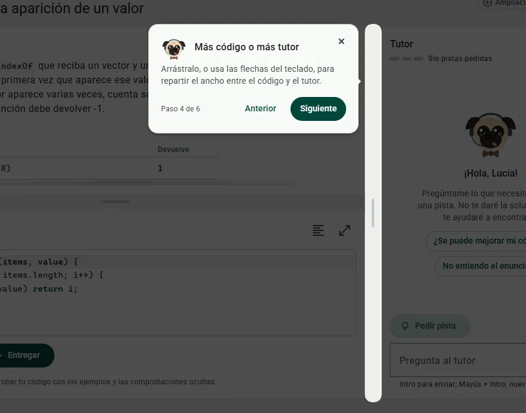

#### 5. Ampliar el código

Le da al código todo el alto; el tutor se recoge en la mascota. Vuelve a pulsarlo para deshacerlo.

#### 6. Fijo o flotante

Deja el tutor en su columna o flotando sobre el código, como prefieras.

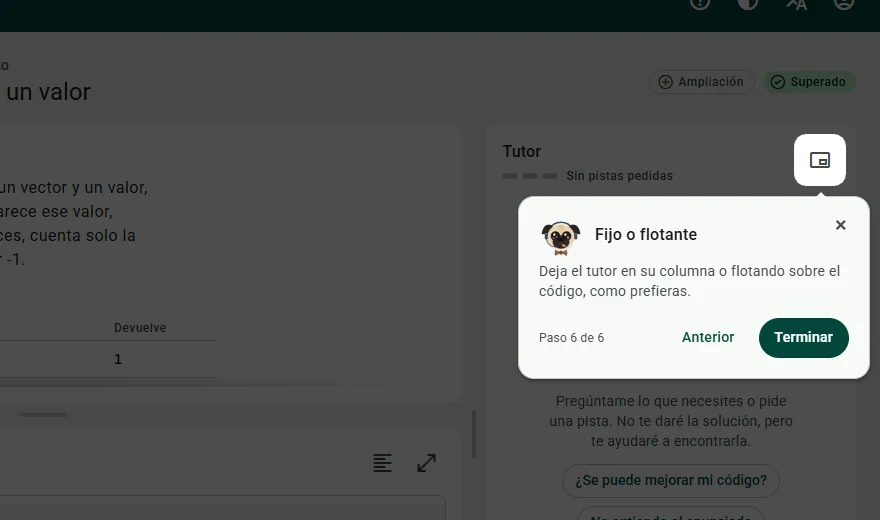

### Ordenar tu código

_Las sangrías y los espacios, de un clic._

#### 1. Formatear el código

Ordena las sangrías y los espacios, como un editor profesional. También con Mayús + Alt + F.

### Practicar de nuevo un ejercicio entregado

_Repetirlo sin cambiar lo que ve tu docente._

#### 1. Practicar de nuevo

Empiezas un intento nuevo para practicar. Lo que entregaste no cambia.

**Qué haces:** Pulsa «Practicar de nuevo»

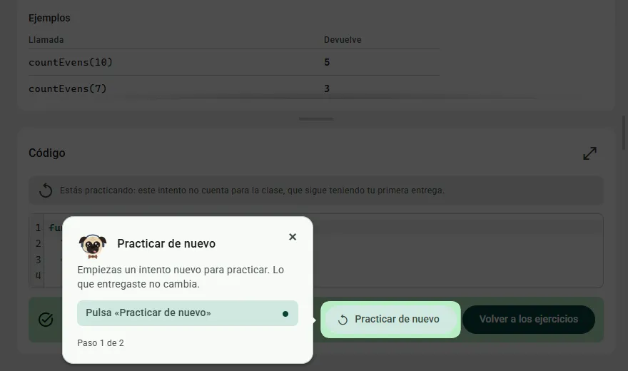

#### 2. Estás practicando

Este intento no cuenta para la clase: tu docente sigue viendo tu primera entrega.

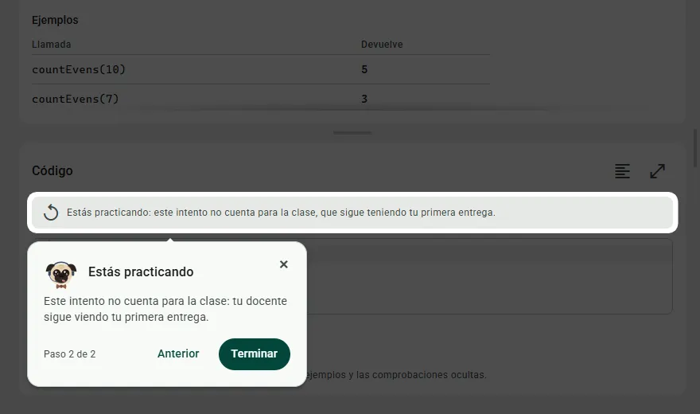

### Volver a un intento anterior

_Releer lo que entregaste antes de practicar._

#### 1. Tus intentos

Cada vez que practicas un ejercicio de nuevo, empiezas un intento. Aquí los tienes todos.

**Qué haces:** Abre la lista de intentos

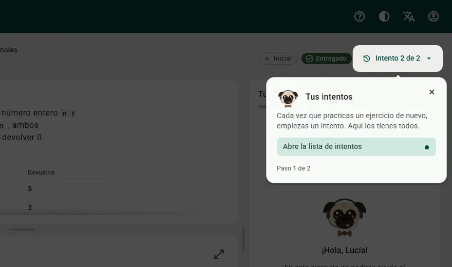

#### 2. Elige uno

Los anteriores solo se leen; en el último puedes seguir trabajando.

**Qué haces:** Elige un intento

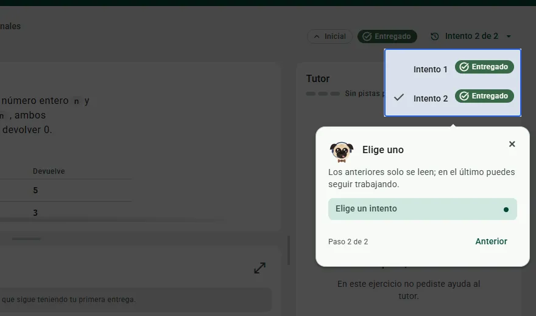

### Pasar al siguiente ejercicio

_Seguir con el tema sin volver al catálogo._

#### 1. Entregado

Cuándo lo entregaste. El código ya no se puede cambiar.

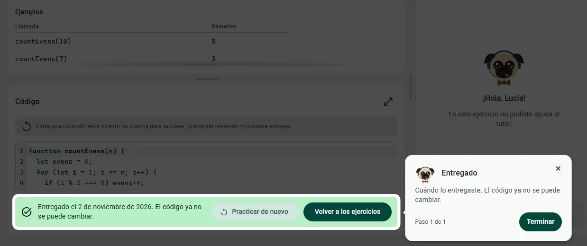

### Ver qué datos se registran

_Saber qué se guarda, para qué y quién lo ve._

#### 1. Tu menú

Aquí tienes tus ajustes, tus datos y la salida.

**Qué haces:** Abre tu menú

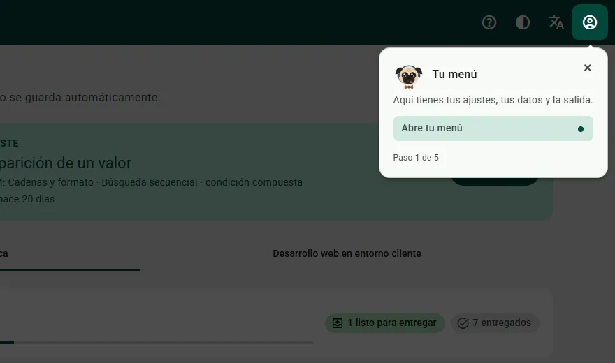

#### 2. Datos registrados

Te dice qué se guarda mientras trabajas, para qué y quién lo ve.

**Qué haces:** Pulsa «Datos registrados»

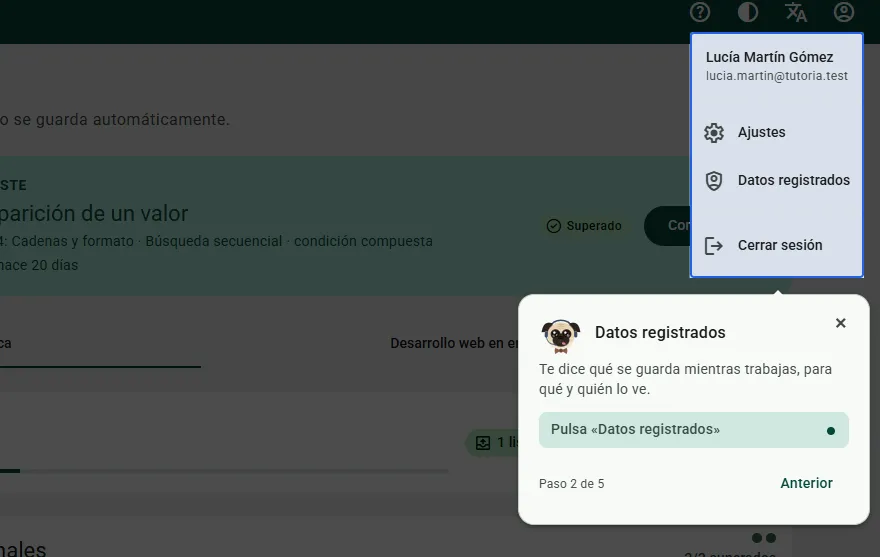

#### 3. Lo que se registra

Tu código, las pruebas, las pistas y la conversación con el tutor, entre otras cosas.

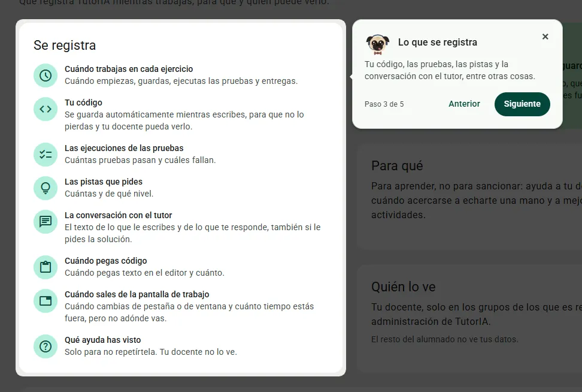

#### 4. Lo que nunca

El audio de tu voz no se graba nunca.

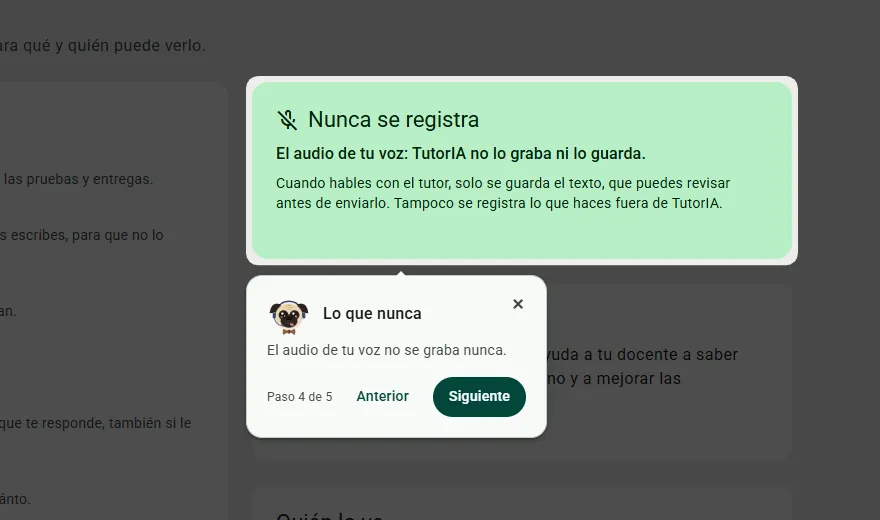

#### 5. Quién lo ve

Tu docente, solo en sus grupos, y la administración. Nadie más.

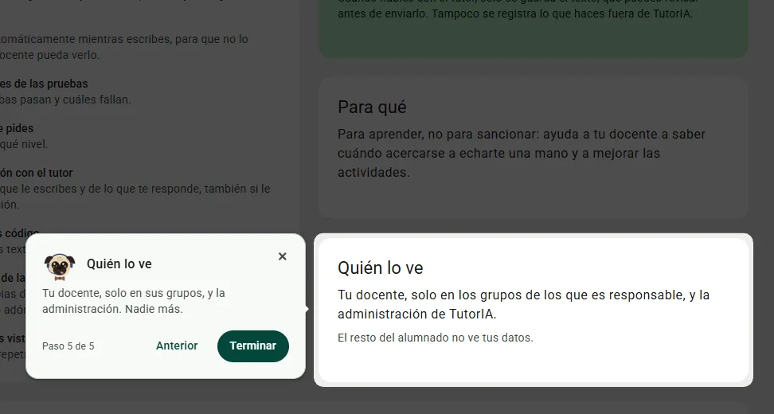

## Recorridos de pantalla

### Conocer tus ejercicios

_Cada pieza del catálogo y de la barra, una a una._

#### 1. Por dónde seguir

El ejercicio que dejaste a medias o, si no hay ninguno, el siguiente que te toca, con su tema, sus contenidos y su fecha de entrega.

#### 2. Empezar o continuar

Abre ese ejercicio donde lo dejaste.

#### 3. Tus asignaturas

Una pestaña por asignatura, cada una con sus temas y ejercicios.

#### 4. Tu progreso

Cuántos ejercicios de la asignatura has superado, de todos los que tienes.

#### 5. Cómo van

Cuántos tienes listos para entregar, con fallos, en curso y ya entregados.

#### 6. Los temas

Cada tema agrupa sus ejercicios, con un punto de color por ejercicio. Pulsa su nombre para plegarlo o desplegarlo; los temas entregados enteros empiezan plegados.

#### 7. El orden

El número del ejercicio en su tema, o una marca cuando ya lo has superado.

#### 8. La dificultad

Inicial, media, avanzada o de ampliación, para ir de menos a más.

#### 9. El estado

Sin empezar, en curso, con fallos, superado (pasa todas las pruebas, aún sin entregar) o entregado.

#### 10. La fecha de entrega

Hasta cuándo tienes para entregarlo, si tu docente puso una fecha.

#### 11. Listo para entregar

Supera todas las pruebas: solo te falta entregarlo.

#### 12. Empezar, continuar o repasar

Abre el ejercicio: «Empezar» si es nuevo, «Continuar» si lo tienes a medias y «Repasar» si ya lo entregaste.

#### 13. TutorIA

Desde cualquier pantalla, te lleva a tus ejercicios.

#### 14. Ejercicios

Tus ejercicios de todas las asignaturas. Sigue subrayado mientras trabajas en uno.

#### 15. Ayuda

Tus primeros pasos, cómo se hace cada cosa, la ayuda de cada pantalla y la bienvenida.

#### 16. Tema

Claro, oscuro o el de tu sistema. Se aplica al momento y se recuerda en este navegador.

#### 17. Idioma

Español, català o English. Los ejercicios también se ven en tu idioma cuando tu docente los traduce.

#### 18. Tu menú

Tu nombre, tus ajustes, tus datos registrados y «Cerrar sesión».

### Conocer la pantalla de trabajo

_El enunciado, el editor, las pruebas y el tutor, pieza a pieza._

#### 1. Volver

A tus ejercicios. Tu código ya está guardado.

#### 2. Dónde estás

La asignatura y el tema del ejercicio. La asignatura te lleva a su pestaña del catálogo.

#### 3. La dificultad

Inicial, media, avanzada o de ampliación, para ir de menos a más.

#### 4. Cómo va

El estado del ejercicio y, después de ejecutar, cuántas pruebas superas.

#### 5. Plegar el enunciado

Pliégalo cuando ya lo tengas claro y el código ganará sitio.

#### 6. El enunciado

Qué tiene que hacer tu función. Lo que va en otro formato es código.

#### 7. Los ejemplos

Llamadas a tu función y lo que debe devolver. Son las pruebas visibles; además hay otras ocultas.

#### 8. Más enunciado o más código

Arrástralo, o usa las flechas del teclado, para repartir el alto entre el enunciado y el código.

#### 9. Formatear el código

Ordena las sangrías y los espacios, como un editor profesional. También con Mayús + Alt + F.

#### 10. Ampliar el código

Le da al código todo el alto; el tutor se recoge en la mascota. Vuelve a pulsarlo para deshacerlo.

#### 11. El editor

Aquí escribes tu función. Ejecuta las pruebas con Ctrl + Intro sin salir de él.

#### 12. Más código o más tutor

Arrástralo, o usa las flechas del teclado, para repartir el ancho entre el código y el tutor.

#### 13. Ejecutar las pruebas

Comprueban tu código con los ejemplos y con pruebas ocultas. Puedes ejecutarlas tantas veces como quieras.

#### 14. Entregar

Se activa cuando superas todas las pruebas. Es definitivo: después ya no se puede cambiar.

#### 15. El nivel de las pistas

Por qué pista vas: cada una te ayuda un poco más que la anterior, sin darte nunca la solución.

#### 16. Fijo o flotante

Deja el tutor en su columna o flotando sobre el código, como prefieras.

#### 17. La conversación

Lo que hablas con el tutor en este ejercicio. A veces señala una línea de tu código o una prueba.

#### 18. Preguntas sugeridas

Para empezar a hablar con el tutor con un solo clic.

#### 19. Pedir pista

El tutor te da una pista para avanzar. Si no basta, pide otra: cada una ayuda un poco más.

#### 20. Pregunta al tutor

Escríbele tu duda con tus palabras. Intro la envía; Mayús + Intro, nueva línea.

#### 21. Enviar

Envía tu pregunta al tutor.

### Conocer tus ajustes

_El tema, el idioma, la mascota, las reacciones y la voz._

#### 1. El tema

Claro, oscuro o el de tu sistema; también desde la barra.

#### 2. El idioma

El de toda la aplicación y, cuando tu docente los traduce, el de los ejercicios.

#### 3. La mascota

Ponle o quítale los cascos y la pajarita, y elige si el puntero se vuelve un hueso sobre ella.

#### 4. Las reacciones

Cómo celebra o te anima el tutor con emojis: completas, reducidas o desactivadas.

#### 5. Emojis animados

Sin ellos, los mismos emojis quietos: más ligeros con una conexión lenta.

#### 6. Probar una reacción

Para ver cómo queda lo que has elegido.

#### 7. Que el tutor te escriba solo

Si llevas un rato sin avanzar, o superas algo que se te resistía, te escribe sin que se lo pidas. Puedes desactivarlo.

#### 8. Hablar con el tutor por voz

Actívalo para escuchar sus respuestas, dictarle y llamarle. Al activarlo, aparecen sus opciones.

#### 9. La voz del tutor

Elige entre las voces de tu equipo y escúchalas antes. Las de mejor calidad salen primero.

#### 10. La velocidad

Lenta, normal o rápida.

#### 11. Leer las respuestas

Te lee en voz alta cada respuesta nueva, sin pulsar «Escuchar».

#### 12. Interrumpir hablando

En una llamada, si hablas mientras el tutor habla, se calla. Mejor con auriculares.

#### 13. Dónde se reconoce tu voz

En este equipo, sin que el audio salga de él, o en el servicio de tu navegador. Si se puede, «Reconocer la voz en este equipo» lo descarga.

#### 14. Privacidad

Qué se registra mientras trabajas y quién lo ve.

### Conocer tus datos registrados

_Qué se guarda, para qué y quién lo ve._

#### 1. Lo que se registra

Cada dato que se guarda mientras trabajas, y para qué.

#### 2. Lo que nunca

El audio de tu voz no se graba nunca, ni lo que haces fuera de TutorIA.

#### 3. Para qué

Para ayudarte a aprender, no para sancionar.

#### 4. Quién lo ve

Tu docente, solo en sus grupos, y la administración. Nadie más.

#### 5. Servicios externos

Qué reciben el proveedor de IA y el reconocimiento de voz de tu navegador.

#### 6. Tú decides

Lo que puedes cambiar en tus ajustes.

